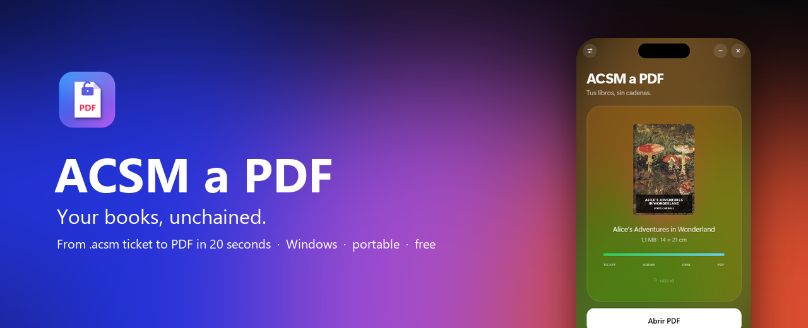

<p align="center">
  
</p>

<p align="center">
  <a href="https://github.com/cervandus/acsm-to-pdf/releases/latest"><b>⬇&nbsp;&nbsp;Download for Windows</b></a>
  &nbsp;&nbsp;·&nbsp;&nbsp;
  <a href="README.md">Español</a>
</p>

<p align="center">
  <a href="https://github.com/cervandus/acsm-to-pdf/releases/latest"></a>
  <a href="https://github.com/cervandus/acsm-to-pdf/releases"></a>
</p>

<p align="center">Windows 10 & 11 · portable, nothing to install · free and open source</p>

---

You buy an ebook and the store hands you an **`.acsm`** file that nothing can open. To read it as a normal PDF you have to install Adobe Digital Editions, create an account, install Calibre, add a plugin and follow about twenty steps.

**ACSM a PDF does it all in one go.** Drop the `.acsm` on the window and about 20 seconds later you have your PDF.

> The app's interface is in Spanish for now. It is simple enough to use without reading it: drop the file, wait, click the big white button.

## How it works

<p align="center">
  
</p>

<p align="center">
  🎟️ <b>Ticket</b> → ☁️ <b>Adobe</b> → 🔓 <b>DRM</b> → 📄 <b>PDF</b>
</p>

1. **Ticket.** Reads the `.acsm` your store gave you.
2. **Adobe.** Asks the store for the book, the same way Adobe Digital Editions would, and downloads it.
3. **DRM.** Removes Adobe's DRM with the key from your authorization.
4. **PDF.** Lays out the book with Calibre: page size based on the cover, page numbers and clickable chapters.

## What makes it special

<table>
  <tr>
    <td width="50%" valign="top">
      <h3>🧳 Portable</h3>
      Unzip and run. No Adobe Digital Editions, no Calibre, no plugins, no accounts. Works from a USB stick.
    </td>
    <td width="50%" valign="top">
      <h3>🎨 Dresses up as your book</h3>
      While converting, the background takes on the colours of the cover. Confetti when it's done.
    </td>
  </tr>
  <tr>
    <td width="50%" valign="top">
      <h3>📐 A PDF shaped like a book</h3>
      Cover proportions, comfortable margins, page numbers and bookmarks. A4, A5 or 6″ e-reader too. If the book already was a PDF, it is kept as is.
    </td>
    <td width="50%" valign="top">
      <h3>🖱️ Double-click</h3>
      Optional: make <code>.acsm</code> files open with the app and convert themselves.
    </td>
  </tr>
</table>

## Getting started

1. Download the `.zip` from the [latest release](https://github.com/cervandus/acsm-to-pdf/releases/latest) and unzip it anywhere.
2. Open **`ACSM a PDF.exe`**.
3. Drag your `.acsm` onto the window. The PDF appears in `Documents\Libros PDF`.

<p align="center">
  
  &nbsp;&nbsp;&nbsp;
  
</p>

## FAQ

<details>
<summary><b>Do I need an Adobe account or Adobe Digital Editions?</b></summary>
<br>
No. The first time you convert a book, the app creates an <b>anonymous Adobe authorization</b> (no account, like ADE's "authorize without an ID") and stores it in the <code>datos</code> folder. If your computer already has an authorized Adobe Digital Editions, the app copies that authorization instead, so it can also open the books you already downloaded with ADE.
</details>

<details>
<summary><b>Why should I keep the <code>datos</code> folder safe?</b></summary>
<br>
It holds your authorization. A book stays tied to the authorization that downloaded it first: if you delete the folder and the app creates a new one, the store won't let you download that book again. Back it up, and don't share it: anyone who has it can open your books.
</details>

<details>
<summary><b>Windows says the app "isn't safe"</b></summary>
<br>
The app isn't signed with a paid certificate, and Windows SmartScreen warns about anything that isn't. Click "More info" and "Run anyway". Some antivirus tools also distrust apps packaged with PyInstaller or that remove DRM; the full source code is in this repository for anyone to review.
</details>

<details>
<summary><b>Why is the .zip 300 MB?</b></summary>
<br>
It contains a full copy of Calibre, the best ebook layout engine around. That way the PDF looks the same on every computer and you don't need to install anything.
</details>

<details>
<summary><b>The store says the book was already downloaded with another authorization</b></summary>
<br>
That <code>.acsm</code> was already redeemed on another computer or with Adobe Digital Editions. Convert it with the copy of the app (or the computer) that downloaded it first.
</details>

<details>
<summary><b>Which stores work?</b></summary>
<br>
Any store that delivers books as Adobe <code>.acsm</code> files (Adobe ADEPT), in EPUB or PDF. It does not work with Kindle, Apple Books or Kobo's own DRM.
</details>

## Legal notice

This tool exists so you can read **the books you have bought**, in the format you prefer, for your **personal use**. Don't use it to share books or to get around library loans. Laws about removing DRM differ from country to country: check yours. The author accepts no responsibility for how it is used. This project is not affiliated with Adobe or any store.

## Building from source

<details>
<summary>Instructions</summary>
<br>

You need Windows, [Python 3.12](https://www.python.org/) and [Calibre](https://calibre-ebook.com/) installed in `C:\Program Files\Calibre2` (it gets copied into the app).

```powershell
pip install -r requirements.txt
powershell -ExecutionPolicy Bypass -File construir.ps1
```

The script writes the public `.zip` to `..\7_PUBLICACION EN GITHUB`, without a `datos` folder.

| File | What it does |
| --- | --- |
| `app.py` | Window (pywebview), settings, `.acsm` file association |
| `motor.py` | The four conversion stages |
| `adobe_portatil.py` | Authorization, fulfilment and decryption using the third-party code |
| `ui/index.html` | The whole interface |
| `terceros/` | DeACSM and DeDRM, unmodified |

</details>

## Thanks to

- **[DeACSM](https://github.com/Leseratte10/acsm-calibre-plugin)** by Leseratte10, which redeems `.acsm` files without Adobe Digital Editions.
- **[DeDRM](https://github.com/noDRM/DeDRM_tools)** by noDRM and the Apprentices, which removes Adobe's DRM.
- **[Calibre](https://calibre-ebook.com/)** by Kovid Goyal, which lays out the PDF. The app ships an unmodified Calibre 9.16; its source code is at [github.com/kovidgoyal/calibre](https://github.com/kovidgoyal/calibre/tree/v9.16.0).
- **[pywebview](https://pywebview.flowrl.com/)** for the window, and **[Standard Ebooks](https://standardebooks.org/)** for the public-domain book in the screenshots.

## License

[GPL v3](LICENSE). You may use, change and redistribute it, commercially too, as long as you share the code under the same license and keep the credits.

---

<p align="center">
  Made as a non-profit project by <b>Cervandus</b>, so nobody else has to follow twenty steps to read their own book.<br>
  <a href="https://instagram.com/cervandus">📷 Instagram @cervandus</a> &nbsp;·&nbsp; <a href="https://github.com/cervandus">GitHub</a>
</p>
