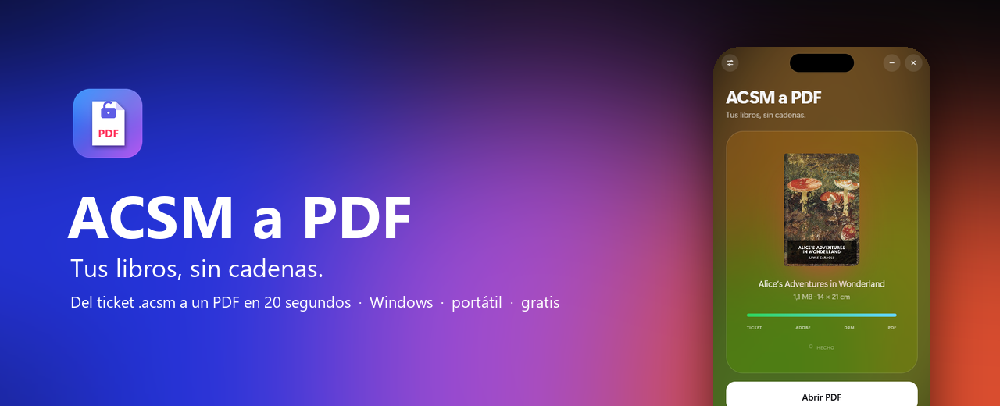
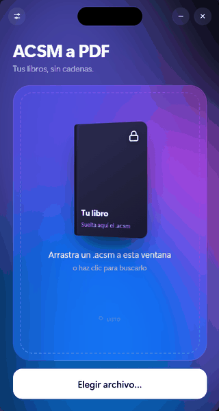
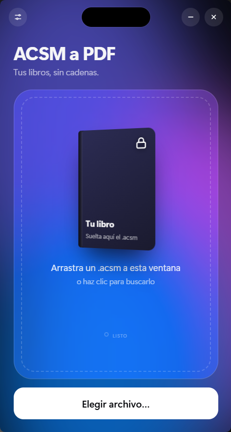
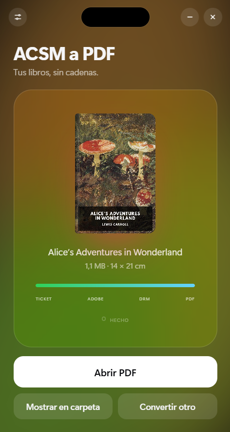

<p align="center">
  
</p>

<p align="center">
  <a href="https://github.com/cervandus/acsm-to-pdf/releases/latest"><b>⬇&nbsp;&nbsp;Descargar para Windows</b></a>
  &nbsp;&nbsp;·&nbsp;&nbsp;
  <a href="README.en.md">English</a>
</p>

<p align="center">
  <a href="https://github.com/cervandus/acsm-to-pdf/releases/latest"></a>
  <a href="https://github.com/cervandus/acsm-to-pdf/releases"></a>
</p>

<p align="center">Windows 10 y 11 · portátil, no se instala · gratis y de código abierto</p>

---

Compras un libro electrónico y la tienda te da un archivo **`.acsm`** que no se abre con nada. Para leerlo como PDF normal hay que instalar Adobe Digital Editions, crear una cuenta, instalar Calibre, añadirle un complemento y seguir una veintena de pasos.

**ACSM a PDF lo hace todo de una vez.** Sueltas el `.acsm` en la ventana y en unos 20 segundos tienes tu PDF.

## Así funciona

<p align="center">
  
</p>

<p align="center">
  🎟️ <b>Ticket</b> → ☁️ <b>Adobe</b> → 🔓 <b>Protección</b> → 📄 <b>PDF</b>
</p>

1. **Ticket.** Lee el `.acsm` que te dio la tienda.
2. **Adobe.** Pide el libro a la tienda, como lo haría Adobe Digital Editions, y lo descarga.
3. **Protección.** Quita el DRM de Adobe con la clave de tu autorización.
4. **PDF.** Maqueta el libro con Calibre: tamaño de página según la portada, números de página y capítulos navegables.

## Qué tiene de especial

<table>
  <tr>
    <td width="50%" valign="top">
      <h3>🧳 Portátil</h3>
      Descomprime y abre. Sin Adobe Digital Editions, sin Calibre, sin complementos ni cuentas. Funciona desde una memoria USB.
    </td>
    <td width="50%" valign="top">
      <h3>🎨 Se viste con tu libro</h3>
      Mientras convierte, el fondo toma los colores de la portada. Al terminar, confeti.
    </td>
  </tr>
  <tr>
    <td width="50%" valign="top">
      <h3>📐 Un PDF con forma de libro</h3>
      Proporción de la portada, márgenes cómodos, números de página y marcadores. También A4, A5 o lector de 6″. Si el libro ya era un PDF, se guarda tal cual.
    </td>
    <td width="50%" valign="top">
      <h3>🖱️ Doble clic</h3>
      Opcional: haz que los <code>.acsm</code> se abran con la app y se conviertan solos.
    </td>
  </tr>
</table>

## Empezar

1. Descarga el `.zip` de la [última versión](https://github.com/cervandus/acsm-to-pdf/releases/latest) y descomprímelo donde quieras.
2. Abre **`ACSM a PDF.exe`**.
3. Arrastra tu `.acsm` a la ventana. El PDF aparece en `Documentos\Libros PDF`.

<p align="center">
  
  &nbsp;&nbsp;&nbsp;
  
</p>

## Preguntas

<details>
<summary><b>¿Necesito una cuenta de Adobe o tener Adobe Digital Editions?</b></summary>
<br>
No. La primera vez que conviertes un libro, la app crea una <b>autorización anónima</b> de Adobe (sin cuenta, como la opción «Autorizar sin ID» de Adobe Digital Editions) y la guarda en la carpeta <code>datos</code>. Si tu ordenador ya tiene Adobe Digital Editions autorizado, la app copia esa autorización, y así puede abrir también los libros que ya descargaste con ADE.
</details>

<details>
<summary><b>¿Por qué tengo que guardar la carpeta <code>datos</code>?</b></summary>
<br>
Porque ahí está tu autorización. Un libro queda ligado a la autorización con la que se descargó la primera vez: si borras la carpeta y la app crea otra, la tienda no te dejará volver a descargar ese libro. Haz copia de seguridad y no la compartas: quien la tenga puede abrir tus libros.
</details>

<details>
<summary><b>Windows dice que la app «no es segura»</b></summary>
<br>
La app no está firmada con un certificado de pago, y Windows SmartScreen avisa de todo lo que no lo está. Pulsa «Más información» y «Ejecutar de todas formas». Algunos antivirus también desconfían de las apps empaquetadas con PyInstaller o de las que quitan DRM; el código completo está en este repositorio para que cualquiera lo revise.
</details>

<details>
<summary><b>¿Por qué el .zip pesa 300 MB?</b></summary>
<br>
Lleva dentro una copia completa de Calibre, el mejor motor que existe para maquetar libros. Así el PDF sale igual en cualquier ordenador y no tienes que instalar nada.
</details>

<details>
<summary><b>La tienda dice que el libro ya se descargó con otra autorización</b></summary>
<br>
Ese <code>.acsm</code> ya se canjeó con otro ordenador o con Adobe Digital Editions. Conviértelo con la copia de la app (o el ordenador) que lo descargó la primera vez.
</details>

<details>
<summary><b>¿Qué tiendas funcionan?</b></summary>
<br>
Cualquiera que entregue los libros como <code>.acsm</code> de Adobe (Adobe ADEPT), en EPUB o en PDF. No sirve para Kindle, Apple Books ni Kobo con su propio DRM.
</details>

## Aviso legal

Esta herramienta existe para que puedas leer **los libros que has comprado**, en el formato que prefieras, para tu **uso personal**. No la uses para compartir libros ni para saltarte préstamos de bibliotecas. Las leyes sobre la eliminación de DRM cambian de un país a otro: infórmate de las del tuyo. El autor no se hace responsable del uso que se haga de ella. Este proyecto no tiene relación con Adobe ni con ninguna tienda.

## Compilar desde el código

<details>
<summary>Instrucciones</summary>
<br>

Necesitas Windows, [Python 3.12](https://www.python.org/) y [Calibre](https://calibre-ebook.com/) instalado en `C:\Program Files\Calibre2` (se copia dentro de la app).

```powershell
pip install -r requirements.txt
powershell -ExecutionPolicy Bypass -File construir.ps1
```

El script deja el `.zip` público en `..\7_PUBLICACION EN GITHUB`, sin carpeta `datos`.

| Archivo | Qué hace |
| --- | --- |
| `app.py` | Ventana (pywebview), ajustes, asociación de `.acsm` |
| `motor.py` | Las cuatro etapas de la conversión |
| `adobe_portatil.py` | Autorización, canje y descifrado con el código de terceros |
| `ui/index.html` | Toda la interfaz |
| `terceros/` | DeACSM y DeDRM, sin modificar |

</details>

## Gracias a

- **[DeACSM](https://github.com/Leseratte10/acsm-calibre-plugin)** de Leseratte10, que canjea los `.acsm` sin Adobe Digital Editions.
- **[DeDRM](https://github.com/noDRM/DeDRM_tools)** de noDRM y los Apprentice, que quita el DRM de Adobe.
- **[Calibre](https://calibre-ebook.com/)** de Kovid Goyal, que maqueta el PDF. La app incluye Calibre 9.16 sin modificar; su código fuente está en [github.com/kovidgoyal/calibre](https://github.com/kovidgoyal/calibre/tree/v9.16.0).
- **[pywebview](https://pywebview.flowrl.com/)** para la ventana, y **[Standard Ebooks](https://standardebooks.org/)** por el libro de dominio público de las capturas.

## Licencia

[GPL v3](LICENSE). Puedes usarla, cambiarla y redistribuirla, también con fines comerciales, siempre que compartas el código con la misma licencia y mantengas la autoría.

---

<p align="center">
  Hecho sin ánimo de lucro por <b>Cervandus</b>, para que nadie más tenga que seguir veinte pasos para leer su libro.<br>
  <a href="https://instagram.com/cervandus">📷 Instagram @cervandus</a> &nbsp;·&nbsp; <a href="https://github.com/cervandus">GitHub</a>
</p>
